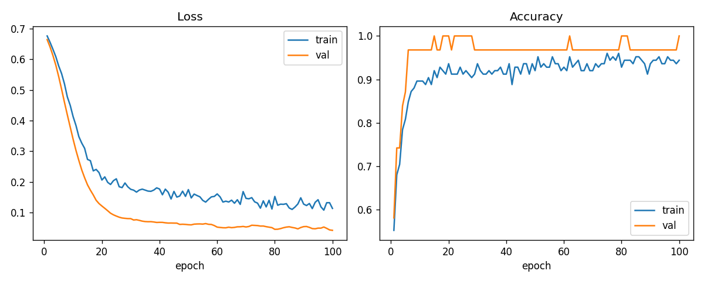

# PyTorch 入门：二分类训练闭环

## 任务目标
用 Dataset/DataLoader 与 MLP 建立完整训练、验证、保存和推理流程，比较标准库基线。提交预测文件，并记录固定种子、损失函数、优化器和训练曲线。

## 评估与验收
Accuracy：预测标签完全正确的比例，越大越好。公开榜只使用部分隐藏测试数据；最终选择的提交在题目关闭并发布私榜后按剩余测试数据排名。不要利用公开榜反复推测标签。

##  数据说明

平台独立生成的小规模教学合成数据；用于练习数据流程、建模与评价，分数不代表真实公开基准表现。
`data/train.csv` 有 target，`data/test.csv` 没有 target。评分用的真实标签仅保存在服务器。`data/sample_submission.csv` 是训练集均值/多数类参考提交，页面参考分对应此文件。`baseline.py` 是可进一步对比的 kNN 起点，在本地运行并生成项目根目录的 `submission.csv`。缺失值、标准化和调参只使用训练集。

## 运行说明

在项目根目录执行：

```bash
pip install -r requirements.txt
python baseline.py
python -m src.train
python -m src.predict
python -m src.plot_curves
python -m src.compare_baseline
```

- `python -m src.dataset`、`python -m src.model` 可单独检查数据和网络前向。
- 训练结果写入 `outputs/best_model.pt` 与 `outputs/history.csv`。
- 测试预测写入 `outputs/submission.csv`，列名为 `id,prediction`。
- 曲线图为 `outputs/curves.png`，对比报告为 `outputs/compare_report.txt`。

## 训练设置

| 项目 | 取值 |
| --- | --- |
| 随机种子 | 42 |
| 划分 | 训练集分层 80/20，当前为 125/31 |
| 预处理 | 缺失值用训练子集均值填补，再用训练子集均值和标准差标准化 |
| 模型 | MLP：4 → 32 → Dropout(0.1) → 16 → 2 |
| 损失函数 | CrossEntropyLoss |
| 优化器 | Adam，学习率 1e-3，weight decay 1e-4 |
| 批大小 / 轮数 | 16 / 100 |
| 最优验证准确率 | 1.0000（第 15 轮首次达到，之后不再被超过） |

验证集只有 31 条，准确率 1.0000 只说明这批留出样本被完全分对，不能当作隐藏测试集分数。

## 与 kNN 基线对比

同一留出验证集上，MLP 准确率为 1.0000，k=5 的 kNN 准确率为 0.9677。两边对 84 条测试样本的预测一致率为 0.8214。kNN 的测试提交仍由 `baseline.py` 在全部训练集上拟合；验证对比时，近邻只来自训练子集，避免把验证样本当作邻居。

